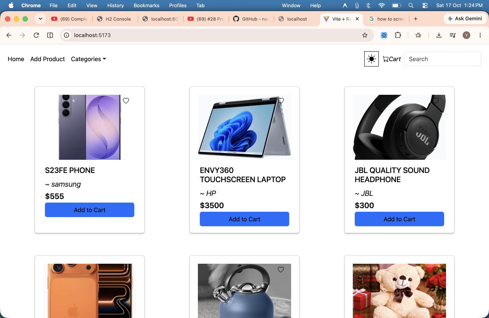
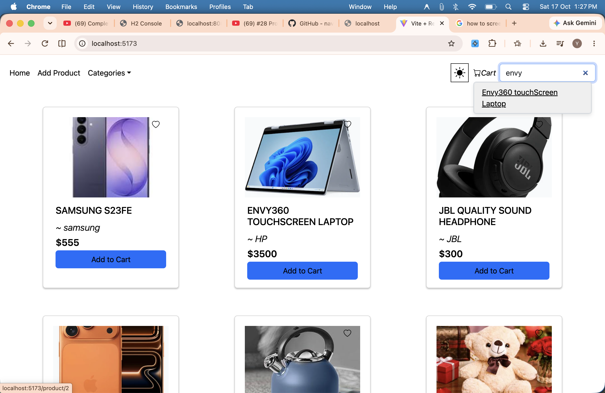
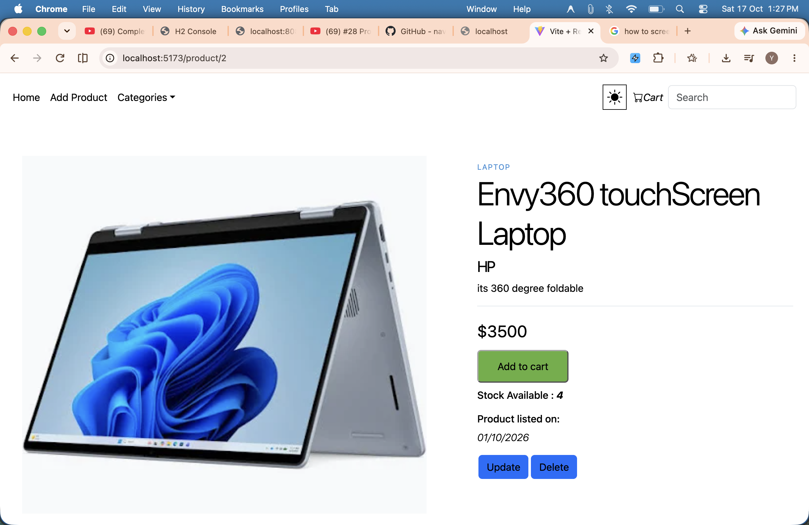
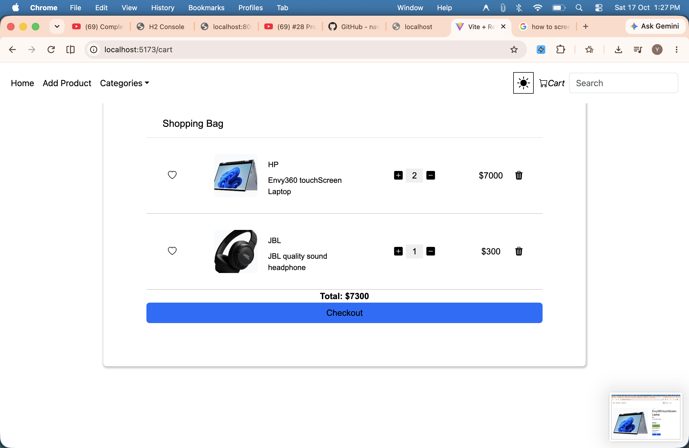
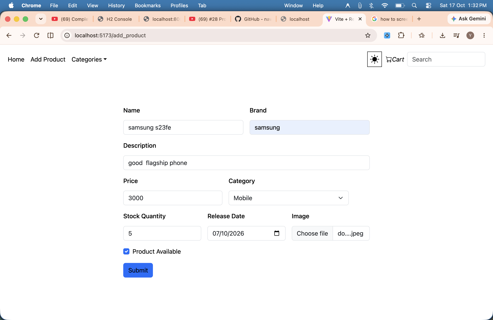
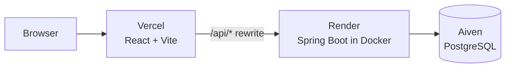

<div align="center">

# 🛒 E-Commerce Web App

**A full-stack e-commerce application with product management, image upload, search, cart and checkout.**

[](https://ecommerce-app-ochre-eight.vercel.app/)
[](https://ecommerce-backend-xlnk.onrender.com/api/products)


[**🚀 Live Demo**](https://ecommerce-app-ochre-eight.vercel.app/) · [**⚙️ API**](https://ecommerce-backend-xlnk.onrender.com/api/products) · [**🐞 Report a bug**](https://github.com/Codersharib/ecommerce-app/issues)

</div>

---

> ⏳ **Note:** the backend runs on a free Render instance that sleeps when idle. The **first request can take up to a minute** while it wakes up. After that it is fast.

## 📸 Screenshots

| Home | Search |
|------|--------|
|  |  |

| Product page | Cart |
|--------------|------|
|  |  |

| Add product |
|-------------|
|  |

## ✨ Features

- **Product management:** add, update and delete products, each with an image upload
- **Product details:** brand, category, description, price, stock and release date
- **Search:** find products by name, description, brand or category
- **Category filter:** browse Laptops, Headphones, Mobiles, Electronics, Toys and Fashion
- **Shopping cart:** change quantities (limited by available stock) and remove items
- **Checkout:** confirm a purchase, and the stock is reduced automatically
- **Light / dark theme:** the choice is remembered in the browser
- **Cloud deployed:** frontend, backend and database are all hosted online

## 🧰 Tech Stack

| Layer | Technology |
|-------|------------|
| Frontend | React (Vite), React Router, Axios, Bootstrap, React-Bootstrap, Context API |
| Backend | Java 25, Spring Boot 4.1, Spring Web MVC, Spring Data JPA (Hibernate), Lombok |
| Database | PostgreSQL (Aiven) |
| Deployment | Vercel (frontend), Render with Docker (backend), Aiven (database) |

## 🏗️ Architecture



Vercel serves the React app and forwards every `/api/...` request to the Spring Boot backend. During local development, the Vite dev server does the same through a proxy.

## 📁 Project Structure

```
ecommerce-app/
├── backend/                      # Spring Boot REST API
│   ├── src/main/java/com/shopping/ECommerceWeb/
│   │   ├── controller/           # REST endpoints
│   │   ├── service/              # Business logic
│   │   ├── repository/           # Spring Data JPA repository
│   │   └── model/                # Product entity
│   ├── src/main/resources/
│   │   └── application.properties
│   ├── Dockerfile
│   └── pom.xml
└── frontend/                     # React + Vite app
    ├── src/
    │   ├── components/           # Home, Product, Cart, AddProduct, UpdateProduct, Navbar...
    │   ├── Context/              # Global state (products, cart)
    │   └── axios.jsx             # Axios instance
    ├── vercel.json               # API rewrite + SPA fallback
    └── vite.config.js            # Dev proxy to the backend
```

## 🔌 API Endpoints

Base URL: `https://ecommerce-backend-xlnk.onrender.com/api`

| Method | Endpoint | Description |
|--------|----------|-------------|
| `GET` | `/products` | List all products |
| `GET` | `/product/{id}` | Get one product |
| `GET` | `/product/{id}/image` | Get the product image |
| `POST` | `/product` | Add a product (multipart: `product` JSON + `imageFile`) |
| `PUT` | `/product/{id}` | Update a product (multipart: `product` JSON + `imageFile`) |
| `DELETE` | `/product/{id}` | Delete a product |
| `GET` | `/products/search?keyword=` | Search by name, description, brand or category |

## 💻 Run Locally

### Prerequisites

- JDK 25
- Node.js 18 or newer
- PostgreSQL

### 1. Clone the repository

```bash
git clone https://github.com/Codersharib/ecommerce-app.git
cd ecommerce-app
```

### 2. Create the database

```sql
CREATE DATABASE ecommerce;
```

### 3. Start the backend

The database login is read from environment variables, so no password is stored in the code.

```bash
cd backend

export DB_URL=jdbc:postgresql://localhost:5432/ecommerce
export DB_USERNAME=postgres
export DB_PASSWORD=your_password

./mvnw spring-boot:run
```

The API runs on `http://localhost:8080`. The `product` table is created automatically on the first start.

### 4. Start the frontend

In a new terminal:

```bash
cd frontend
npm install
npm run dev
```

Open `http://localhost:5173`. The Vite dev server proxies `/api` requests to the backend on port 8080.

## ☁️ Deployment

| Part | Service | Notes |
|------|---------|-------|
| Frontend | **Vercel** | Root directory `frontend`, Vite preset. `vercel.json` forwards `/api/*` to the backend and serves `index.html` for all other routes. |
| Backend | **Render** (Docker) | Root directory `backend`, built from the `Dockerfile`. |
| Database | **Aiven** | Free PostgreSQL service. |

Environment variables set on Render:

```
DB_URL        jdbc:postgresql://<host>:<port>/defaultdb?sslmode=require
DB_USERNAME   <database user>
DB_PASSWORD   <database password>
```

## 🧠 What I Learned

- Debugging a failing request: Jackson cannot map `null` into a primitive `int`, so the entity used `Integer` and field names had to match the frontend JSON
- Handling `multipart/form-data` for image upload (`@RequestPart`) and raising the upload size limits
- Avoiding SQL reserved words such as `desc` as column names, so the field became `description`
- Making one Spring Boot app run on different databases (H2, MySQL, PostgreSQL) by moving credentials into environment variables
- Writing a JPQL search query with `LIKE` across several columns
- Deploying a full stack on free tiers: Docker on Render, Vercel rewrites to avoid CORS issues, and a managed PostgreSQL database
- Keeping secrets out of Git

## ⚠️ Known Limitations

- Product images are stored inside the database, so keep each image **small (under 1 MB)**. A production app would use object storage such as S3.
- There is no user login or payment gateway. Checkout only updates stock.
- The free hosting tiers sleep when idle, so the first load is slow.

## 🙏 Acknowledgements

The project started from the Spring Boot and React course by [Telusko](https://www.youtube.com/@Telusko). I extended it with product search, the update-product page, PostgreSQL support, environment-based configuration and full cloud deployment.

## 👤 Author

**Sharib Kausar**

- GitHub: [@Codersharib](https://github.com/Codersharib)
- LinkedIn: <!-- add your LinkedIn profile link here -->

---

<div align="center">

If you like this project, please consider giving it a ⭐

</div>
